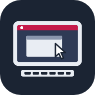

#  Pi Connect App

**Your Raspberry Pi lab, from anywhere.**

Pair an Android device with a keyboard and mouse, open this app, and you're at your Raspberry Pi's desktop — wherever your feet take you, as long as there's an internet connection. It's close to carrying your PC around with you, without carrying your PC around.

The app is a thin wrapper around [Raspberry Pi Connect](https://www.raspberrypi.com/software/connect/), Raspberry Pi's official remote access service. Raspberry Pi Connect does all the hard work: secure screen sharing and a remote shell from any browser, with no port forwarding or VPN. It's a great thing, and all credit for it goes to the Raspberry Pi team.

I made this app for my own needs. It isn't perfect, but it does everything I need. Btw, it's also entirely vibe-coded. I didn't want to burn my time on it — in the end, it's just a wrapper.

> This is an unofficial project and isn't affiliated with or endorsed by Raspberry Pi Ltd. Raspberry Pi is a trademark of Raspberry Pi Ltd.

## 💭 Why I built it

I wanted a super portable PC, and my Raspberry Pi 5 was collecting dust. So I got a mini BT keyboard and mouse, and turned my Android tablet (and phone) into that PC: the tablet is the screen, the Pi does the computing.

The catch was screen sharing in a mobile browser. The remote desktop never displayed properly: on my phone the resolution made it unusable, and on the tablet I had to zoom in and out to fix it every time I connected. That got annoying fast.

I didn't want to use the browser for this at all. I wanted a separate app that opens everything in fullscreen in two clicks — open the app, then **Connect via → Screen sharing** — and works right away, without any zooming.

I don't need super performance. I live mainly in the terminal and the browser, and a Raspberry Pi 5 with a fast NVMe drive handles that just fine.

I also use it to manage my home lab: a headless Raspberry Pi 4 cluster, which I reach through the remote shell.

## ✨ What it does

- 🖥️ **A sharp desktop that fills the screen.** The app gives Raspberry Pi Connect your screen's real resolution, so the desktop isn't tiny and blurry. Screen sharing opens straight into fullscreen.
- 🧹 **Nothing but your desktop.** No address bar or tabs, and Android's status bar, navigation bar and taskbar are hidden. Swipe in from a screen edge when you need them.
- 🎯 **Only what you need.** After you sign in, you see just your device list and your sessions. Menus and account pages are hidden, and links to other sites open in your regular browser.
- ⌨️ **Made for a physical keyboard.** Android grabs Alt+Tab before any app can see it, so the real Alt key can't switch windows on the Pi. The workaround: **Right Ctrl acts as Alt**, so Right Ctrl + Tab switches windows. Weird, but hell, it works. The on-screen keyboard also stays out of the way.
- 🔍 **Adjustable size.** Make everything larger or smaller with the volume keys. Your choice is remembered.
- 🔁 **Stable sessions.** Rotating the screen or attaching the keyboard doesn't reload the session.

## ⌨️ Controls

| Key | What it does |
|---|---|
| **Volume up / down** | Makes everything larger or smaller: 0.5× to 3×, default 1.25×. They don't change the volume in this app. |
| **Right Ctrl** or **Menu** | Acts as **Alt** on the Pi: + Tab switches windows, + Shift + Tab goes back, + F4 closes a window. |
| **Back** | Leaves fullscreen, then goes back a page. |
| **Swipe from a screen edge** | Shows Android's system bars briefly. |

Every other key, including Left Ctrl, goes to the Pi as usual.

## 🚀 Getting started

No SSH, VPN, port forwarding or direct connection to your Pi needed. All you need is a Raspberry Pi with Raspberry Pi Connect, and voilà.

1. **Set up Raspberry Pi Connect on your Pi.** It's super easy with [Raspberry Pi Imager](https://www.raspberrypi.com/software/): turn on Raspberry Pi Connect in the OS customisation settings when you write the SD card, and the Pi shows up in your device list after its first boot. For other ways, see [the documentation](https://www.raspberrypi.com/documentation/services/connect.html).
2. **Download the APK** from the [Releases](https://github.com/r4d01/piconnect-app/releases) page.
3. **Install it on your Android device.** You'll need to allow installing apps from unknown sources for your browser or file manager.
4. **Open PiConnect**, sign in with your Raspberry Pi ID, and choose **Connect via** next to one of your devices.

Requires Android 5.0 or newer. Hiding the system bars and the on-screen keyboard works best on Android 11 or newer.

### 💡 Recommended setup

- **A tablet with a BT keyboard and mouse.** A phone works too, and so does touch, but a remote desktop is much nicer with real input devices.
- **Turn off the on-screen keyboard for physical keyboards** in Android's settings, usually under **Settings → System → Keyboard → Physical keyboard → Use on-screen keyboard**. The app hides it anyway, but with this off, the taskbar doesn't even flash when you click into a text field.
- **Check Android's physical keyboard layout** under **Settings → System → Keyboard → Physical keyboard**. With a keyboard attached, the app types characters using that layout. If you have more than one (say US and Czech), switch between them with **Ctrl+Space**. Wrong quotes or symbols usually mean the wrong layout is active.
- **Nothing extra on the Pi.** Raspberry Pi OS already switches windows with Alt+Tab.

### 🔄 Upgrading

Uninstall the old app, then install the new APK. Android refuses to install a new build over the old one because each build is signed with a different key. Uninstalling clears the app's data, so you'll need to sign in and set your size again.

## 🔒 Security

Your Raspberry Pi ID gives access to every Pi you've connected to it, and you sign in to it inside this app.

- **Turn on two-factor authentication** for your Raspberry Pi ID. I recommend it whether you use this app or not.
- **Don't trust unverified sources blindly, including this one.** Sign-in happens on Raspberry Pi's own pages, and the app doesn't read or store your password. But this APK comes from an unverified developer, so you only have my word for that. The full source code is in this repo: read it, or build the APK yourself.

## ⚠️ Known limitations

- 🔀 **Real Alt+Tab and the Super key go to Android**, not to the Pi. Use Right Ctrl + Tab instead. Super can't be passed through.
- 🎛️ **Right Ctrl isn't a Ctrl key** in this app, because it stands in for Alt. Left Ctrl works normally.
- 🚪 **No sign-out button**, because Raspberry Pi Connect's menus are hidden. To sign out, clear the app's data: **Settings → Apps → PiConnect → Storage → Clear data**.
- ✍️ **Dead keys may not combine** while a physical keyboard is attached, for example `ˇ` then `c` for `č`. Letters that are directly on a key work fine.
- 🧩 **It depends on Raspberry Pi Connect's web pages.** If Raspberry Pi Connect changes its "Enter full screen" button or its device list layout, automatic fullscreen or the trimmed device list may stop working until the app is updated.
- 🔇 **No sound.** Raspberry Pi Connect's screen sharing doesn't transfer audio.

## 🛠️ Building

GitHub Actions builds the APK ([`.github/workflows/build.yml`](.github/workflows/build.yml)):

- Every push to `main` builds a debug APK and attaches it to the workflow run as the `piconnect-debug` artifact.
- Pushing a tag like `v1.0` also publishes the APK on the Releases page.

To build locally, you need JDK 17, the Android SDK and Gradle 8.6 on an x86_64 machine. Run `gradle assembleDebug`, and the APK ends up in `app/build/outputs/apk/debug/`. The Android build tools don't run on a Raspberry Pi, which is why the project relies on CI.
